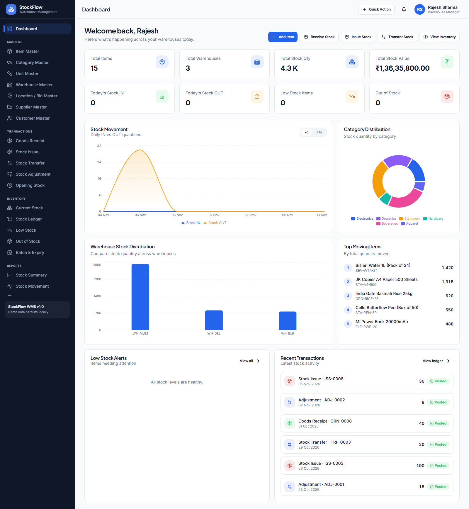
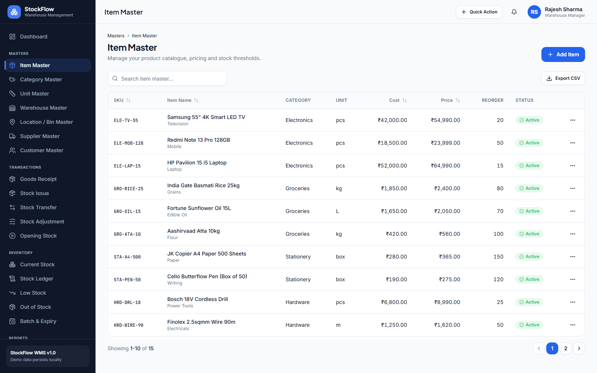
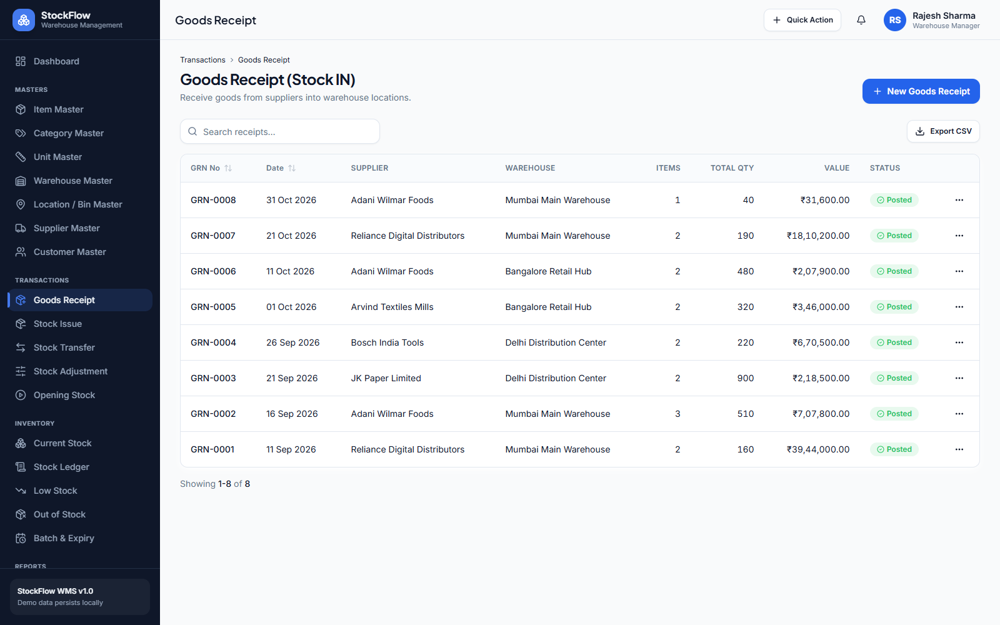
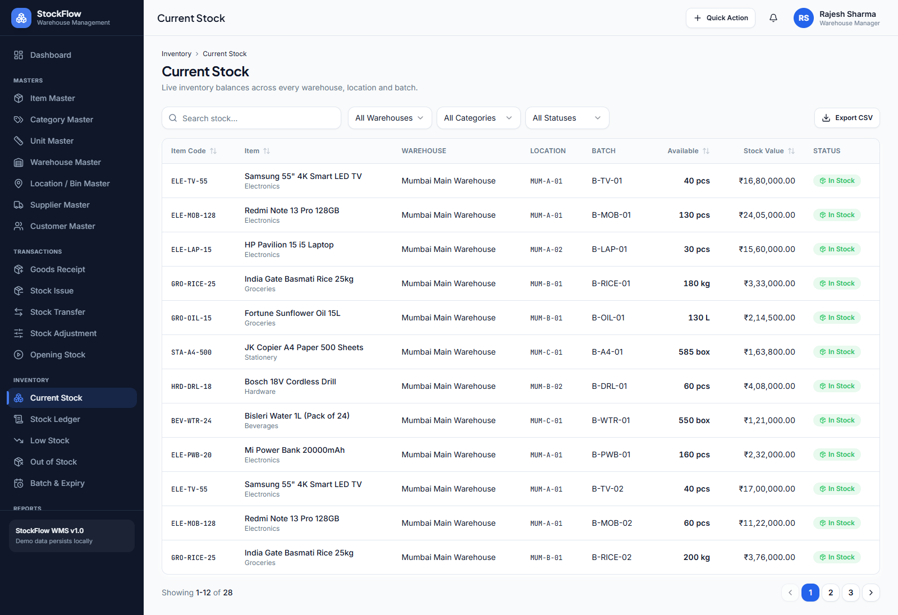
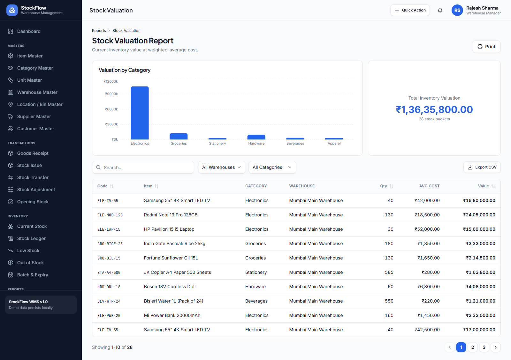

# StockFlow — Warehouse Management

Manage products, warehouse locations, stock movements, and inventory reporting from one responsive interface.


StockFlow is a **frontend warehouse-management demo** with 27 pages, seeded inventory data, reusable management screens, and browser-local persistence. It runs without a backend, database server, or API credentials.

**Demo URL:** https://imkumardeepak.github.io/WarehouseManagement/

The project is configured for free GitHub Pages hosting with automatic deployments from `main`. Type checking and production builds use compatible Zod 4 and Vite 8 dependencies.



[Getting started](#getting-started) · [Features](#features) · [Screenshots](#screenshots) · [Stock workflow](#stock-workflow) · [Project structure](#project-structure)

## Features

### Dashboard

- Inventory KPIs: item count, warehouse count, total quantity, and stock value.
- Today's stock IN and OUT totals.
- Stock-movement trends with 7-day and 30-day views.
- Category and warehouse stock distribution charts.
- Top-moving items, low-stock alerts, and recent transactions.
- Quick navigation to common stock operations.

### Master data — 7 pages

- **Items:** SKU, barcode, category, unit, pricing, and stock thresholds.
- **Categories:** Product grouping with optional parent categories.
- **Units:** Measurement symbols and decimal-quantity preferences.
- **Warehouses:** Facility types, addresses, and contact details.
- **Locations / bins:** Warehouse zones, racks, shelves, bins, and capacity fields.
- **Suppliers and customers:** Contact details, addresses, and GSTIN fields.
- Shared create, edit, detail, delete, search, sort, pagination, and CSV-export interfaces.

### Transactions — 5 pages

- **Goods receipt:** Receive supplier stock with batch, expiry, location, quantity, and cost details.
- **Stock issue:** Issue inventory to customers or departments with availability checks.
- **Stock transfer:** Move inventory between warehouses and locations.
- **Stock adjustment:** Record physical counts and adjustment reasons.
- **Opening stock:** Enter starting quantities and costs.
- Save documents as drafts or post them to affect inventory.
- Print goods-receipt, stock-issue, and stock-transfer documents.

### Inventory — 5 pages

- Current stock by item, warehouse, location, and batch.
- Stock ledger with movement types and running bucket balances.
- Low-stock and out-of-stock item lists.
- Batch-expiry tracking with expired, 7-day, 30-day, and 90-day windows.
- Filters, searchable tables, and CSV exports.

### Reports — 6 pages

- Stock summary.
- Stock movement.
- Stock valuation.
- Goods receipt report.
- Stock issue report.
- Warehouse-wise stock report.
- Printable report views and CSV exports.

### Settings — 3 pages

- Company details, default warehouse, and expiry-warning preferences.
- Five accent themes: blue, emerald, violet, rose, and amber.
- Editable demo user profile.
- Demo-data reset with confirmation.

## Screenshots

Actual application screenshots captured using seeded demo data. Dates, totals, and chart values vary with the seed date and subsequent local changes.

### Item master

Maintain the product catalogue, pricing, categories, units, and reorder thresholds.



### Goods receipt

Review supplier receipts, warehouse destinations, quantities, values, and document statuses.



### Current stock

Explore stock buckets across warehouses, storage locations, and batches.



### Stock valuation

Inspect category-level valuation charts and detailed inventory-cost rows.



## Technology stack

- **Application:** React 18 and TypeScript with strict checking.
- **Tooling:** Vite 8, npm, PostCSS, and Autoprefixer.
- **Routing:** React Router.
- **Styling:** Tailwind CSS 3 with CSS-variable design tokens.
- **UI primitives:** Radix UI and class-variance-authority.
- **Forms:** React Hook Form, Zod, and Hook Form resolvers.
- **Charts and animation:** Recharts and Framer Motion.
- **Icons and dates:** Lucide React and date-fns.
- **State and persistence:** React Context and browser localStorage.

## Getting started

### Prerequisites

- **Node.js 22.12+ or Node.js 24 LTS**; the screenshot session used Node.js 24.
- npm and Git.
- A modern browser such as Chrome, Edge, or Firefox.

### Install and run

```bash
git clone https://github.com/imkumardeepak/WarehouseManagement.git
cd WarehouseManagement
npm ci
npm run dev
```

Open **http://localhost:5173**. If that port is occupied, use the address printed by Vite.

No `.env` file or sign-in is required. The first visit initializes demo data automatically.

### Available scripts

- `npm run dev` — Start the Vite development server.
- `npm run lint` — Run TypeScript checking with `tsc --noEmit`; this is not an ESLint check.
- `npm run build` — Run TypeScript checking, then create a production bundle in `dist/`.
- `npm run preview` — Serve an existing production build locally.

`npm run preview` requires a successful build first.

### Free deployment with GitHub Pages

The workflow in `.github/workflows/deploy.yml` installs locked dependencies, builds with Node.js 24, and publishes `dist/` to GitHub Pages on pushes to `main`. It can also be started manually from the repository's Actions tab.

- Repository **Settings → Pages → Source** must be set to **GitHub Actions**.
- The workflow sets `GITHUB_PAGES=true` so Vite builds assets under `/WarehouseManagement/`.
- Local development and regular builds retain the `/` base path.
- Hash-based routing lets direct links and refreshes work without server rewrites. For example: https://imkumardeepak.github.io/WarehouseManagement/#/inventory/current-stock
- Deployment status and build logs are available in [GitHub Actions](https://github.com/imkumardeepak/WarehouseManagement/actions/workflows/deploy.yml).

Hosting serves the frontend only. Each browser retains its own independent demo data; deployment does not create a shared database.

## Stock workflow

1. **Prepare master data:** Create categories, units, items, warehouses, and storage locations.
2. **Initialize inventory:** Post opening stock, or receive goods from a supplier.
3. **Save or post documents:** Drafts do not affect stock. Posting triggers inventory recalculation.
4. **Move or reconcile stock:** Issue items, transfer them between locations, or record physical-count adjustments.
5. **Monitor inventory:** Review balances, ledger movements, reorder alerts, and expiry windows.
6. **Export or print:** Download table data as CSV or print supported documents and reports.

### How inventory is derived

`src/services/inventory.ts` rebuilds balances and ledger entries from posted documents in chronological order.

- A stock bucket is identified by **item + warehouse + location + batch**.
- Opening stock and receipts increase quantity.
- Issues decrease quantity.
- Transfers create paired outbound and inbound movements.
- Adjustments apply the difference between physical and recorded system quantity.
- The engine calculates bucket-level average costs for incoming movements.

Posting validation and state mutations live in `src/store/WmsContext.tsx`. Display lookups and report aggregates live in `src/store/selectors.ts`.

## Demo data and persistence

The seeded dataset includes:

- **15 items** across **6 categories** and **5 units**.
- **3 warehouses:** Mumbai, Delhi, and Bangalore.
- **12 storage locations**, **5 suppliers**, and **5 customers**.
- **20 posted documents:** 1 opening stock, 8 receipts, 6 issues, 3 transfers, and 2 adjustments.
- Batches with different expiry windows, including an expired example.

Data is stored in the current browser under:

- `stockflow_wms_state` — Application data.
- `stockflow_wms_version` — Stored-state schema version.
- `stockflow_theme_color` — Selected accent theme.

**Persistence is local to the browser and origin.** Different browsers, devices, hostnames, or ports have separate data. Clearing site storage removes locally saved changes.

To restore the seed dataset, go to **Settings → Demo Data Reset** and confirm the reset. This discards local application-data changes; the separately stored accent theme is retained.

## Project structure

```text
WarehouseManagement/
├── docs/images/              # README screenshots
├── public/                   # Static assets
├── src/
│   ├── components/
│   │   ├── common/           # Shared tables, forms, filters, badges, dialogs
│   │   ├── layout/           # App shell, header, sidebar, navigation
│   │   ├── transactions/     # Shared transaction form controls
│   │   └── ui/               # Styled UI primitives
│   ├── data/seed.ts          # Demo dataset
│   ├── lib/                  # CSV, formatting, printing, utilities
│   ├── pages/
│   │   ├── Dashboard.tsx
│   │   ├── inventory/        # 5 inventory pages
│   │   ├── masters/          # 7 master-data pages
│   │   ├── reports/          # 6 report pages
│   │   ├── settings/         # 3 settings pages
│   │   └── transactions/     # 5 transaction pages
│   ├── services/             # Inventory engine and storage adapter
│   ├── store/                # WMS state, selectors, theme provider
│   ├── types/                # Domain interfaces
│   ├── App.tsx               # Routes
│   ├── index.css             # Global styles and theme tokens
│   └── main.tsx              # App entry point and providers
├── package.json
├── tailwind.config.js
└── vite.config.ts
```

## Known limitations


### Demo scope

- There is no backend, server-side database, authentication, or role-based authorization. Editing the profile role does not grant or restrict access.
- Data is not synchronized between users or devices. CSV export is not a full application backup.
- Stock costing and posting rules are demo implementations and need further validation before operational or financial use; transfer-in movements currently do not carry source cost or expiry metadata.
- Some preferences are stored but not fully enforced: date formatting is fixed in the formatter, decimal-unit preferences do not constrain transaction quantities, and location capacities are not enforced.
- No automated unit or end-to-end test suite is configured.
- Routes use `#/...` URLs so static hosts do not need application-route rewrites.

## Contributing

Open an issue describing a bug or proposed improvement before making a large change. Keep changes focused and include reproduction steps, screenshots for UI changes, and relevant validation results in pull requests.

## License

No license file is currently included. Public repository visibility alone does not grant an open-source license.
